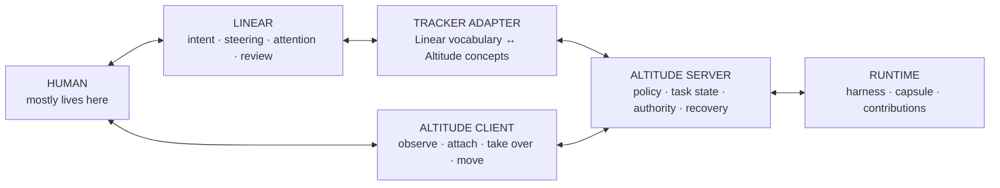
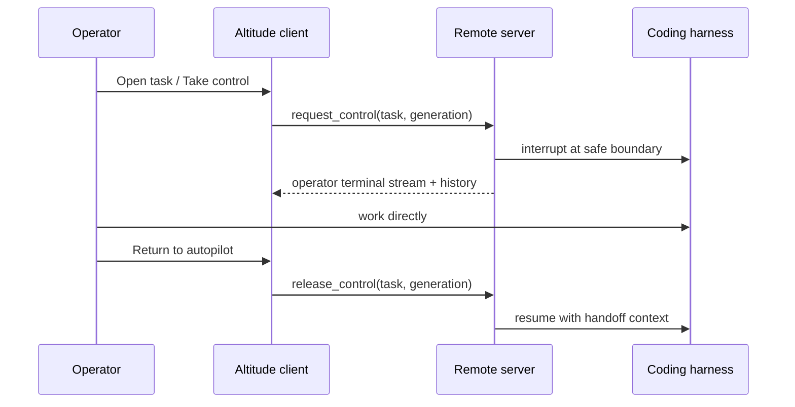
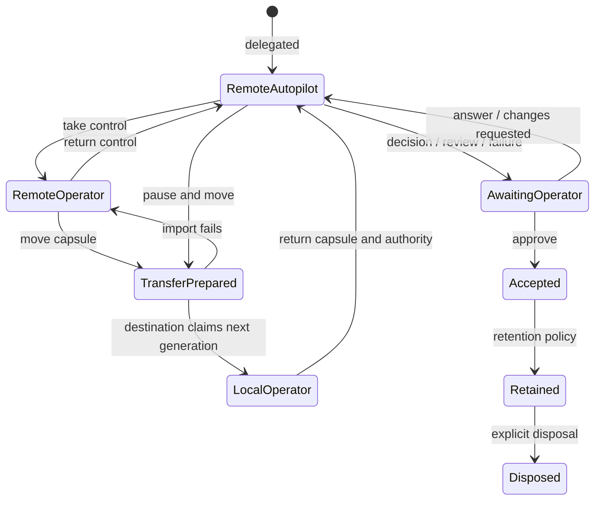

# Altitude server mode: pilot delegated work from Linear

Status: product and architecture sketch for review. This proposes a direction; it does not describe implemented behavior.

> Reviewed 2026-10-03. The agreed decisions, including the points below that were
> replaced, are in [`decisions.md`](./decisions.md), which takes precedence.

## The promise

Assign a Linear issue to Altitude. Altitude runs it on a chosen server, keeps the work moving within the operator's intent, asks for judgment only when it matters, and returns reviewable evidence. The operator should be able to conduct almost the whole task from Linear.

Open an Altitude client when you want to watch more closely, talk directly to the coding harness, repair its environment, or take the whole capsule somewhere else. Hand it back and the task continues under autopilot.

The existing TUI already proves the key control gesture:

```text
                    ENTER                         ESC

       ┌─────────────────────────┐      ┌─────────────────────────┐
       │ AUTOPILOT               │ ───▶ │ OPERATOR                │
       │ Altitude drives harness │      │ human drives harness    │
       └─────────────────────────┘ ◀─── └─────────────────────────┘

                    same task · same capsule · same conversation
```

Server mode makes that gesture work across machines and gives it a tracker-native front door.

## Product boundary

Pi Durable, Claude Code, Pi, and future harnesses provide execution machinery. Linear provides an issue graph, notifications, collaboration, and review affordances. Microsandbox provides an isolated capsule and a snapshot format.

Altitude owns the opinionated delegation loop:

- what the task is trying to accomplish;
- when work may continue autonomously;
- when the operator's judgment is required;
- which evidence makes the result reviewable;
- who currently has control;
- when work is accepted and when its capsule may be disposed of.

The task capsule remains the source of operational truth. Linear is the operator's cockpit and a durable projection of the parts that belong in a shared task tracker. A Linear issue is not a second task database, and a harness conversation is not the task.

## The fat-marker architecture



One server initially means one Rust process with clear internal boundaries, not a flock of services:

```text
  public HTTPS                         private host boundary

  Linear webhook ──▶ [ tracker adapter ]
                          │
  Altitude client ─────▶ [ command/query API ]
                          │
                     [ task controller ] ──▶ SQLite event history
                          │
                     [ runtime manager ] ──▶ Microsandbox
                          │                       │
                          │                  Claude / Pi
                          └───────────────────────┘
```

The adapter never reaches around the controller to manipulate a sandbox. The TUI, remote client, and Linear adapter all ask the same controller to perform semantic operations.

## The portable concepts

### Task

A durable delegated intention with lifecycle, attention, contributions, and acceptance. It may outlive any one issue, conversation, process, capsule instance, or server.

### Capsule

The execution state needed to continue the task: filesystem, repository state, harness session, environment identity, and checkpoint metadata. Credentials and other node-local identities are references or capabilities, not portable capsule contents.

### Node

An Altitude server capable of owning and running capsules. A laptop can be a node too; “local” and “remote” describe the operator's current point of view, not different products.

### Control authority

Exactly one node has the right to advance a task at a time. Within that node, either Altitude or an attached operator drives the harness. This needs a durable generation or lease so a stale server cannot resume after the capsule moved elsewhere.

### Tracker binding

A durable link between one Altitude task and an external tracker object. It stores stable external IDs, adapter-specific projection state, and idempotency cursors. The generic task model never stores “Linear comment means X.”

### Operator signal

An update, decision, review, or failure raised by the control loop. Signals have their own durable identity and resolution state. The tracker adapter chooses the best surface its tracker offers.

### Contribution

A reviewable external result such as a branch, pull request, preview, document, or artifact. Altitude observes it as input to the control loop; a contribution changing does not automatically become an interruption.

## A Linear issue as an Altitude cockpit

Straylight has already exposed several truths worth keeping:

- assigning or mentioning an agent is a meaningful action; an ordinary comment is often only context;
- live progress can be ephemeral, while decisions and final results need durable records;
- a nonblocking update and a blocking request need different surfaces;
- Linear Agent Session elicitation is the native reply path for a paused agent;
- only one blocking elicitation fits cleanly in a session, while independent comment threads can carry several nonblocking questions;
- webhook deliveries must be persisted before acknowledgement and processed idempotently;
- issue status, agent-session status, controller state, and actual execution can disagree after a crash;
- evidence belongs beside review, and access repair needs an explicit route back to the affected node.

Those are observations from the prototype, not reasons to copy its controller into Altitude. The generic mapping should be:

| Altitude meaning | Linear reference interaction |
| --- | --- |
| Delegate | Assign the issue to an Altitude app user, or invoke a deliberate “Delegate to Altitude” action |
| Intent | Issue title, description, selected attachments, and the delegation event's context |
| Progress | Agent Plan plus replacement-style ephemeral activity; durable comments only for useful milestones |
| Update | Same-issue comment; urgent updates mention the operator |
| Decision | Blocking Agent Session elicitation plus a durable same-issue context comment |
| Review | Blocking elicitation with evidence and **Approve** / **Request changes** choices |
| Failure | Durable error with a concrete repair or retry action; task remains retained |
| Steering while active | Explicit mention or reply addressed to Altitude; delivered after the current safe boundary |
| New context | Ordinary comments and edits update the issue projection but do not silently redirect a running agent |
| Stop | Explicit stop action, unassignment, or a configured terminal state; controller records what actually stopped |
| Contribution | Native issue attachment for PR, preview, document, or artifact URL |
| Acceptance | Review approval or an explicitly mapped terminal transition; never inferred from process exit |
| Deferred discovery | A justified follow-up subissue linked to the parent task |

Linear priority stays the human's planning signal. Altitude signal priority should affect notification and ordering without rewriting issue priority.

## The everyday journey

### 1. Delegate from Linear

```text
  You assign ENG-421 to “Altitude · Straylight”
       │
       ▼
  Linear immediately shows:  Preparing capsule on Straylight…
       │
       ▼
  Altitude binds ENG-421 ↔ task alt_01…, selects an environment,
  provisions the capsule, and starts the configured harness.
       │
       ▼
  The issue moves to the team's started state only after Altitude accepts it.
  A native plan shows the current shape of the work.
```

If repository or environment selection is ambiguous, that is the first steering request. The server must not guess its way into an unrelated repository.

The issue should show a compact node identity—“Running on Straylight”—and an **Open in Altitude** link. It should not expose sandbox IDs, container names, conversation IDs, or internal turn machinery.

### 2. Let it work

Normal tool activity remains quiet. Linear gets enough ephemeral activity to establish liveness and a durable milestone when something becomes useful to the operator: a contribution exists, a decision was made within granted intent, or the work changed phase.

The operator can add context freely. Altitude incorporates edits and ordinary comments at the next safe context refresh, but only explicit addressing—an `@Altitude` mention, an elicitation reply, or a dedicated action—is treated as steering.

This prevents “looks relevant” from becoming accidental command parsing.

### 3. Resolve attention in Linear

```text
  ┌───────────────────────────────────────────────────────────┐
  │ Steering needed: migration strategy                       │
  │                                                           │
  │ The existing database contains unreleased local state.    │
  │ Recommendation: rebuild it and keep the event log schema  │
  │ simple.                                                   │
  │                                                           │
  │ [ Rebuild local state ]  [ Preserve it ]  [ reply… ]      │
  └───────────────────────────────────────────────────────────┘
```

The signal ID, not comment text, links the reply to the paused task. A duplicate webhook returns the already-recorded result. A late reply to a resolved signal becomes new context and is never applied retroactively as though the old decision were still open.

For review:

```text
  ┌───────────────────────────────────────────────────────────┐
  │ Review ready: remote attach survives reconnect            │
  │                                                           │
  │ PR #84 · terminal recording · verification notes          │
  │ Known limit: capsule transfer has not been exercised.     │
  │                                                           │
  │ [ Approve work ]  [ Request changes ]                     │
  └───────────────────────────────────────────────────────────┘
```

Approval records human acceptance. Requesting changes answers the same review signal and resumes the same task and capsule.

### 4. Take direct control without moving the capsule

Most “pull” gestures should first be a remote attach. Moving a live capsule is expensive and often unnecessary.



The capsule remains on the server. The client streams terminal output, input, resize events, and connection state. A dropped client connection does not immediately hand work back to autopilot: the server holds operator control for a short reconnect window, then pauses safely and asks what to do. Silence must never unexpectedly become autonomous execution.

Linear reflects only the meaningful state: “Operator took control” and, if it lasts, “Waiting for operator.” Keystrokes and terminal transcripts stay out of the tracker.

### 5. Move the capsule to the local node

Literal pull is a separate, explicit operation in the Altitude client:

```text
  REMOTE OWNS             MOVING                LOCAL OWNS

  Straylight              no one runs it        MacBook
  generation 17    ───▶   snapshot + manifest ───▶ generation 18
  task paused             hash verified          task paused
  fallback retained       claim recorded         ready to attach
```

The handoff protocol should be conservative:

1. The source controller reaches a safe boundary and records `transfer_prepared` with a new transfer ID.
2. Microsandbox produces a snapshot; Altitude packages a portable manifest containing task history cursor, environment identity, harness kind and continuation metadata, contributions, and outstanding signals.
3. The client downloads the encrypted transfer or streams it directly to the destination node. Node-local credentials are excluded.
4. The destination verifies compatibility, imports the snapshot, and proves that it can read the task and harness continuation state.
5. Authority advances to a new generation on the destination.
6. The source marks its copy superseded but retains it for a bounded recovery window.

If import fails before authority advances, the source remains owner. If acknowledgement is lost after authority advances, both nodes consult the recorded generation; the source may never resume generation 17.

“Send back to Straylight” runs the same protocol in the other direction. This is capsule mobility, not git synchronization. A branch alone cannot carry an uncommitted workspace, a harness conversation, outstanding attention, and environment state.

## Client UX

The current TUI can grow into a client of an embedded or remote server without losing its feel.

```text
  ⛰ altitude                              Straylight ● connected

  NEEDS YOU
  ┌ ENG-421  Review ready · remote attach reconnect ──────────┐
  │ PR #84 · 3 checks passed · 1 known limitation             │
  └────────────────────────────────────────────────────────────┘

  WORKING
  ┌ ENG-433  autopilot · implementing webhook recovery ───────┐
  │ Straylight · Claude · 12m                                  │
  └────────────────────────────────────────────────────────────┘

  YOUR CONTROL
  ┌ ALT-19   operator override · attached here ────────────────┐
  │ MacBook · Pi · terminal available                          │
  └────────────────────────────────────────────────────────────┘

  enter attach/take control   p pull here   b return to autopilot
```

The default view is an attention and ownership view, rather than a miniature process monitor. Selecting a task can reveal history, contributions, node, environment, and raw terminal access.

The client remembers named server connections. The first version can require explicit pairing; automatic network discovery is helpful later but not required for the core journey.

## Server setup UX

There are two separate setup jobs: make a node capable of running Altitude, then connect a tracker to that node.

### Start a node

The target experience:

```text
  $ altitude server init

  Name this node: Straylight
  Capsules:        /var/lib/altitude/capsules
  Public URL:      https://altitude.example.net
  Isolation:       Microsandbox ✓
  Harnesses:       Claude ✓   Pi ✓

  Node created: Straylight
  Pair another client with:
      altitude connect https://altitude.example.net
```

`altitude server doctor` should verify the real journey prerequisites: writable durable storage, SQLite health, snapshot create/restore, harness authentication, HTTPS reachability, and webhook delivery—not merely that the process is listening.

For the first implementation, deployment can be documented as one server binary managed by the host's service manager, plus an operator-provided HTTPS reverse proxy or private-network ingress. A Docker package may be useful, but the product model should not assume Docker: Microsandbox and the host service are the meaningful dependencies.

### Connect Linear

```text
  $ altitude tracker connect linear

  Opening Linear to install “Altitude · Straylight”…

  Workspace:  Acme
  Teams:      Engineering
  Delegate:   assign issues to Altitude · Straylight
  Attention:  use “In Review” while awaiting a decision
  Webhook:    received and acknowledged ✓

  Try it: assign ALT-1 to Altitude · Straylight.
```

The install flow should create or validate the OAuth installation, webhook endpoint, app-user identity, accessible teams, and configured attention state. Setup is complete only after a signed test delivery reaches the server and the server can publish a private test activity or run a purpose-built dry run.

Secrets stay on the server. A task capsule receives semantic, task-scoped capabilities, never the Linear token or webhook secret.

## Finding servers

Discovery has three layers, and only the first is required initially:

1. **Explicit pairing.** Give the client a URL, authenticate the node, name it, and pin its identity. This works across LANs, Tailscale, and public HTTPS without a central Altitude service.
2. **Tracker-visible identity.** Each installed Linear app user has a human-readable node or pool name such as `Altitude · Straylight`. Assignment naturally chooses where work runs. A later shared app may route by team or environment, but it should not obscure ownership.
3. **Local discovery.** mDNS can advertise nearby nodes for convenience. It does not establish trust; pairing still pins a node identity.

A hosted global registry is premature. It introduces an account and availability dependency before we know that explicit pairing is painful.

## Server API shape

The first protocol should expose domain operations, plus a narrow byte stream for the one irreducibly terminal-shaped interaction.

```text
  Queries                 Commands                 Streams
  ───────                 ────────                 ───────
  list tasks              delegate                 task events
  read task               answer signal            terminal output
  read signals            acknowledge update       transfer progress
  read history            request control
  read contributions      return to autopilot
                          pause / resume / cancel
                          prepare / claim transfer
```

Every command carries:

- a client-generated command ID for idempotency;
- the expected task generation when authority matters;
- actor and source metadata for audit and projection;
- an optional tracker delivery ID or external reference.

The server commits the semantic result before acknowledging the command. Clients reconnect from a history cursor and receive current state before live changes. Terminal bytes are transient; execution-mode transitions and operator inputs worth resumption are durable semantic events.

The in-process TUI should use the same application interface before it uses a network transport. That keeps “server mode” from growing a second controller alongside the existing event loop.

## State and authority sketch

Execution status and control authority are related but separate:



This is deliberately not the complete task status enum. It sketches the user-visible ownership journey. In implementation, transfer state and authority generation deserve their own concepts rather than being squeezed into `Running` / `Paused`.

## Conflicts and recovery

The uncomfortable cases define whether this feels trustworthy:

- **Linear sends the same event twice:** the adapter returns the first recorded result.
- **Linear says “Done” while a run is active:** the configured binding decides whether that means acceptance or cancellation; Altitude records the resulting command and does not delete the capsule.
- **An operator attaches while autopilot is inside a tool call:** Altitude requests a handoff, interrupts at the safest available boundary, then reports whether the action completed, failed, or became indeterminate.
- **Two clients request control:** the first committed authority claim wins; the other sees who owns control and may request a transfer rather than stealing it.
- **The attached client disappears:** retain operator control for a reconnect grace period, then pause. Never silently resume autopilot.
- **The server restarts:** rebuild task state from durable events, inspect the actual capsule and harness state, reconcile tracker status, then decide whether execution is safe to resume.
- **Tracker delivery is down:** continue work when policy permits, queue durable outbound projections, and surface degraded tracker control to connected Altitude clients.
- **A contribution changes externally:** record the observation and let the task policy decide whether it requires work or attention.
- **A capsule moves:** old authority generations reject commands and cannot start execution.

## What to reuse from Straylight

Keep the learned behavior:

- signed, fresh, durable webhook intake with a deduplication ledger and dead-letter visibility;
- controller-owned tracker credentials and semantic capability brokering;
- clear distinction between ephemeral progress and durable activity;
- native Agent Sessions, plans, elicitation, attachments, and reactions where they genuinely work;
- explicit nonblocking signal, blocking steering, review approval, and deferred follow-up semantics;
- bounded inbound files and task-private materialization;
- recovery that consults Linear's current state instead of blindly replaying a previous turn;
- concrete access-repair paths and honest degraded states.

Leave behind prototype-shaped coupling:

- a session as the primary identity of work;
- Linear-specific state in the task controller;
- one server process being synonymous with one engineer's persistent harness profile;
- comments inferred as commands without an explicit addressing rule;
- deployment topology encoded into the product concepts;
- task lifecycle inferred from runner completion.

## Suggested slices

### Slice 1 — make the current TUI a client of a controller boundary

Define command, query, event-subscription, and terminal-stream interfaces around the current `TaskService` / `TaskEventLoop`. Keep everything in one process and preserve the existing interaction. This is complete when create, attention reply, take control, terminal attach, and return to autopilot all travel through that boundary in a real terminal.

### Slice 2 — one headless server, one remote client

Run the controller without the TUI. Pair a client explicitly, list remote tasks, attach to a running harness, disconnect/reconnect, and return it to autopilot. Keep the capsule on the server. This proves the remote version of the interaction already working locally.

### Slice 3 — Linear as the primary cockpit

Build the generic tracker binding and a Linear adapter. Prove one journey with the TUI closed:

```text
assign issue
  → task accepted
  → autopilot works
  → steering requested in Linear
  → reply resumes same task
  → contribution attached
  → review requested with evidence
  → changes requested
  → revised work approved
  → capsule retained
```

Use the Straylight code as a behavior catalogue and test oracle, not a codebase to port wholesale.

### Slice 4 — literal capsule transfer

Move a paused capsule from server to laptop, attach locally, return it, and prove that only the current authority generation can run it. Exercise incompatible environment and interrupted-transfer paths before describing capsule mobility as seamless.

### Slice 5 — deployment and discovery polish

Package service installation, `server doctor`, tracker setup diagnostics, mDNS convenience, node pools or routing rules, and retention controls after the core journey has produced real friction.

## Decisions to make before Slice 3

1. **Linear app identity:** one app installation per Altitude node/pool, or one shared app that routes tasks. Recommendation: one visibly named node or small pool first; routing can follow observed demand.
2. **Delegation gesture:** assignment alone, explicit action, or both. Recommendation: assignment is the default; an explicit action handles teams that cannot or do not want agent assignees.
3. **Terminal issue states:** which Linear states mean pause, cancellation, acceptance, and archival. This must be configured per team and shown during setup.
4. **Ordinary comments:** context-only until explicitly addressed, or always steering. Recommendation: context-only; mentions and replies to an open signal are commands.
5. **Review authority:** whether Linear approval is sufficient acceptance or whether Altitude also requires an explicit client action. Recommendation: allow the binding to declare Linear's review action authoritative and record it as an Altitude acceptance event.
6. **Public ingress:** operator-provided URL, bundled tunnel, or private network only. Recommendation: accept an HTTPS URL first and make `server doctor` excellent; do not make Altitude depend on one tunnel vendor.
7. **Remote control authentication:** node-local client certificates, short-lived pairing tokens, or an identity provider. Recommendation: one-time pairing that issues a revocable per-client credential and pins the node identity.

## The product test

Server mode is working when the operator can forget that the Altitude server has a terminal UI at all:

- Linear is sufficient for delegation, steering, attention, review, and acceptance.
- The Altitude client can recover the full task view from any paired node.
- Taking direct control feels like opening the same agent, not starting a support session beside it.
- Returning control gives Altitude enough durable context to continue safely.
- Moving a capsule cannot create two active owners.
- A restart, duplicate webhook, lost client, or tracker outage produces an understandable state instead of silent double work.

That is the opinionated layer Altitude contributes: the wiring disappears until the operator deliberately asks to see it.
